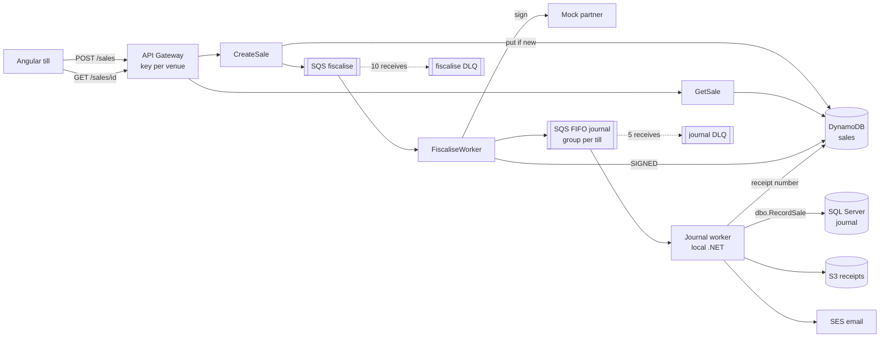

# roller

Fiscal receipts for venue tills in France, Germany and Austria. Each sale is priced under its market's VAT rules, signed by a
fiscal partner, numbered without gaps per till in a SQL Server journal, and its receipt stored in S3 and emailed. C# on AWS
Lambda, CDK in C#, an Angular till.



1. The till posts a sale with its venue's API key and an `Idempotency-Key`. CreateSale prices it and writes it with
   `attribute_not_exists(SaleId)` under an id derived from the venue and key, then queues it and answers 202. A resend with the
   same key returns the stored sale with `Idempotent-Replayed: true`; the same key with a different body gets 422.
2. FiscaliseWorker calls the partner and moves the sale from PENDING to SIGNED with a version check. A failed call backs off on
   the message (5 s doubling to 60 s, plus jitter); after 10 receives the message goes to the DLQ and the alarm emails.
3. The journal worker takes each till's sales in order from the FIFO queue. `dbo.RecordSale` gives the sale the till's next
   receipt number in the same transaction that journals it. The worker then writes the receipt to S3 and emails it when the
   customer gave an address.
4. The till polls `GET /sales/{saleId}` until the receipt number arrives.

## Run

Needs the .NET 10 SDK, Node 24, Docker, the AWS CDK CLI, k6, and an AWS CLI profile named `roller`. Everything deploys to
eu-west-2.

```sh
export AWS_PROFILE=roller
cdk bootstrap                                   # once per account
echo '{"alertEmail": "you@example.com"}' > cdk.context.json   # alarm and SES address; journal.sh reads it too
cdk deploy --all                                # confirm the SNS and SES emails AWS sends
scripts/journal-db.sh up                        # SQL Server in Docker, schema applied
scripts/journal.sh                              # journal worker, leave it running
scripts/till-config.sh && (cd web/till && npm ci && npm start)   # till on http://localhost:4200
```

| Task | Command |
| --- | --- |
| Unit tests | `dotnet test` |
| Unit and SQL Server tests | `scripts/journal-db.sh test` |
| Partner switches | `scripts/partner.sh healthy \| slow <ms> \| errors <rate> \| outage` |
| One drill | `load/drill.sh baseline \| slow \| outage \| poison \| burst` |
| Check invariants after drills | `python3 scripts/verify.py` |
| Mark drills on the dashboard | `cdk deploy RollerTill` (reads `load/drills.json`) |
| Tear down | `scripts/teardown.sh && scripts/journal-db.sh down` |

`scripts/teardown.sh` deletes RollerTill. RollerGuardrails (budget, alarm topic, SES identity) has termination protection and
stays.

## Results

k6 drove 50 tills (17 Paris, 17 Berlin, 16 Vienna) on 27 October 2026, resending 7% of sales under the same key.
`scripts/verify.py` then checked the stores against each other with the pipeline idle.

| Drill | Load | Accepted | API p95 | Signed p95 | Result |
| --- | --- | --- | --- | --- | --- |
| Baseline, 4 journal consumers | 10/s for 10 min | 5,429 | 179 ms | 0.09 s | All 381 resends returned the original sale. |
| Slow partner | 20/s for 5 min, partner answers in 2 s | 4,829 | 155 ms | 89 s | Signing ran at about 15/s, so a queue built up; the API was unaffected. |
| Partner outage | 10/s for 8 min, partner down 4 min | 4,229 | 136 ms | 283 s | Sales made during the outage signed within 300 s, none dead-lettered. |
| Poison messages | 5 malformed or unknown-sale messages | | | | All 5 in the DLQ within 4 s; the alarm emailed 3 min later. |
| Burst | paris-01 at 150/s for 1 min, Berlin and Vienna 4/s between them | 3,306 | 123 ms, with the 429s | 1.6 s | paris-01 got 6,041 429s and about 51/s through; Berlin and Vienna got 241 of 241. |
| Baseline, 16 journal consumers | 10/s for 10 min | 5,430 | 141 ms | 0.08 s | Receipt number 0.35 s after the sale (p50), 0.49 s (p95). |

"Signed" is the time from sale to partner signature. The first five drills ran with 4 journal consumers, which fell
behind; see the findings.

After the drills, with 23,277 sales:

- k6's accepted count equals the sales stored for every run, and each sale's receipt number in DynamoDB equals the journal's.
- 51 tills, 23,277 receipts, no missing or repeated numbers.
- VAT per sale and rate in the journal equals DynamoDB's for all 23,277 sales.
- No sale left PENDING or signed without a receipt.

| Lambda | Invocations | Cold starts | Init p50 | Init p95 |
| --- | --- | --- | --- | --- |
| CreateSale | 24,747 | 59 | 370 ms | 828 ms |
| FiscaliseWorker | 29,762 | 4 | 516 ms | 561 ms |
| MockPartner | 35,927 | 73 | 502 ms | 969 ms |

### Findings

- **Journal deadlocks.** The first baseline logged 213 SQL Server deadlocks in 7 minutes. OPENJSON's fixed 50-row guess,
  squared by the nested call, made the `JournalLine` foreign key check scan every `JournalEntry`, and the scan waited on
  other tills' uncommitted entries. `OPTION (LOOP JOIN)` turned it into a seek; after 3 more from calls already
  running, none followed.
  `ConcurrentSalesOnManyTillsDoNotDeadlock` fails on the old procedure.
- **Journal throughput.** Four journal consumers managed 8 sales/s against 10-20/s arriving, so receipts fell up to 13
  minutes behind. Sixteen managed 31/s; SQL Server sat at 20% CPU, so each consumer waits on round trips to AWS. 16 is now
  the default, and the rerun baseline had receipts within 0.49 s (p95).
- **Signing throughput.** With a 2 s partner, the worker's cap of 5 concurrent invocations of 10 sales each signs about
  15/s. The cap protects the partner; raising it trades partner load for lag.
- **Outages.** Backoff caps at 60 s plus up to 20% jitter, so signing resumes within about a minute of recovery. A sale
  reaches its 10th receive 375 to 450 s after it was queued, so an outage longer than that dead-letters sales; they need
  a redrive once the partner is back.
- **Dashboard.** A sale backing off is in flight, so the visible-messages metric showed an empty queue during the outage.
  The dashboard now plots in-flight messages too.

## What each service does here

| Service | Job |
| --- | --- |
| API Gateway (REST) | One usage plan with a key per venue, limiting each key to 50 requests/s, burst 100, 300,000 a day. 200/s per method. |
| Lambda (.NET 10, arm64) | CreateSale, GetSale, FiscaliseWorker, mock partner. |
| DynamoDB | Sales: conditional put for idempotency, `Version` for optimistic locking. Partner: one signing counter per till. |
| SQS | Fiscalise queue with partial batch failures and per-message backoff. FIFO journal queue grouped per till. A DLQ each. |
| SQL Server 2022 | Journal: gapless numbers per till, Z-report (`GROUPING SETS`, running totals, `LAG`), `ReceiptGaps` view. |
| S3 | Receipts as HTML, written once (`If-None-Match: *`). |
| SES | Receipt email. |
| SSM Parameter Store | Partner switches for the drills. |
| Secrets Manager | Shared secret between the worker and the partner. |
| CloudWatch | Dashboard `roller-till`, DLQ alarms to email through SNS. |
| AWS Budgets | $10 monthly budget with email alerts. |

## Known limits

- The partner is a mock. Real ones (fiskaly for DE and AT, NF525-certified software for FR) need onboarding and certification.
- Tax rules are simplified: per-line rounding, a few categories per market, no discounts, refunds or tips.
- CreateSale writes the sale and sends the queue message as two calls. A crash between them leaves a PENDING sale nobody
  signs. The fix is an outbox: DynamoDB Streams feeding the queue.
- Receipt numbers are assigned after signing. RKSV (AT) and NF525 (FR) chain the number into the signature, so production
  numbers before signing.
- Signing happens after the till has accepted the sale. KassenSichV and RKSV expect the signature at the time of sale,
  and selling while the signer is down is allowed only under each regime's outage procedure.
- The journal numbers sales in queue arrival order, which can differ from the partner's signature counter for the same till.
- The receipt email is sent before `EmailedAt` is saved, so a crash in between sends it twice.
- API keys only meter each venue. Anyone holding a key can post sales; production needs an authorizer (Cognito or IAM).
- The journal worker runs on a laptop against SQL Server in Docker, emulated on Apple Silicon. Production would run it on ECS
  against RDS.
- SES is in the sandbox and sends only to verified addresses.
- The `ByVenueDay` index is written but nothing reads it yet.
